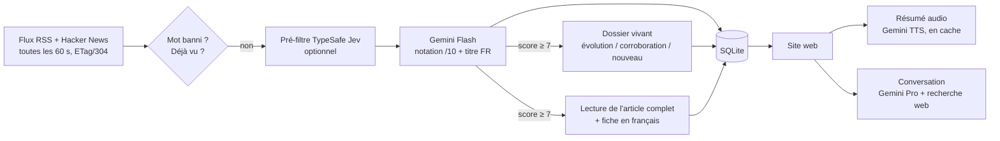

# 🗞️ Xena — veille d'actualité personnelle

Xena lit en continu des médias d'investigation et tech, note chaque publication, et présente les news importantes sur un site privé (Mac / iPad, via Tailscale) :

- **À lire** : une fiche en français pour chaque news importante — l'essentiel, le récit, pourquoi ça compte, la version de la partie mise en cause, les concepts expliqués.
- **À écouter** : un résumé audio lu calmement (voix Gemini, générée une fois puis mise en cache).
- **À retenir** : deux fois par jour (7 h et 19 h), une **synthèse 12 h** en tête du fil : une phrase qui porte le jugement, l'action à faire ou « rien », puis le confirmé, le faux ou non confirmé, ce qui a changé et ce qui ne se passe pas (voir `SYNTHESE.md`).
- **À recevoir** : Xena s'installe comme une app (Safari → Partager → Sur l'écran d'accueil) et envoie une **notification push** pour les vraies méga-dingueries seulement (voir plus bas).
- **À faire** : l'onglet **Tâches**, la to-do partagée avec l'agent Agenda (voir plus bas).
- **À suivre** : une histoire qui évolue est un seul **dossier vivant**. Sa carte dit en une phrase où en est la situation (« Trump suspend les discussions avec Moscou », puis « Trump relance les négociations avec la Russie ») ; le fil se déplie étape par étape, les nouvelles depuis la dernière lecture en avant.
- **À discuter** : on parle à voix haute à une IA de haut niveau sur l'article ou un concept qu'on ne comprend pas. Pas de coupure automatique : on prend le temps de formuler, on appuie pour envoyer. Réponse lue lentement, vitesse réglable.

## Pipeline



**Priorité** : les avancées technologiques et scientifiques et les annonces vraiment nouvelles (dévoilements, percées, nouveaux modèles d'IA, spatial, découvertes publiées), puis les grandes révélations d'investigation.
**Score** = 0,40 × portée + 0,35 × rupture + 0,25 × solidité (démontré, publié, officiel vs rumeur). Dans le fil, un point indique l'importance : rouge ≥ 8,5, orange ≥ 7,5, jaune ≥ 6,5, blanc en dessous.
**Confiance** : chaque news porte un statut (confirmé / allégué / démenti) et sa raison en une ligne, en tête de la fiche. Dans le fil, rien quand c'est confirmé, « ? » quand c'est allégué, « ✗ » quand c'est démenti.
**Dossiers** : chaque news importante est rangée par Gemini Flash (un appel de plus par news ≥ 7). Si elle change l'état d'un dossier, une étape s'ajoute au fil ; si elle raconte un fait déjà connu, elle compte comme source supplémentaire (×2, ×3…) et n'est pas relue dans le flash audio. Au démarrage, les news des dernières 24 h sans dossier sont rangées une fois.
**Sécurité** : CERT-FR (alertes et avis) et le catalogue CISA KEV, filtrés sans appel IA sur les composants critiques (réglages ⚙︎). Chaque source a un niveau (1 primaire, 2 chercheur reconnu, 3 presse, 4 réseau social) qui sert de point de départ à la confiance.
**Synthèse 12 h** : modèle fort (`GEMINI_SYNTH_MODEL`, Pro par défaut) pour la synthèse et le contradicteur, Flash pour le regroupement et l'importance ; heures réglables par `SYNTHESE_HEURES=7,19`. Une échéance manquée (redémarrage) est rattrapée au démarrage. `main.py --synthese` en produit une tout de suite. Le bouton ✎ envoie une remarque au gap log, que chaque synthèse relit.
**Notifications push** (`alertes.py`, Web Push VAPID, iOS 16.4+ depuis l'écran d'accueil) : une news ne part en push que si elle est très grave (faille exploitée ou critique sur l'infra, méga-faille avérée sur un langage, événement mondial de premier plan), confirmée par une source primaire ou par deux sources indépendantes, jamais déjà notifiée (un fait = un push, un dossier = au plus un push par 12 h), et si un dernier contrôle par Gemini Flash juge qu'elle mérite d'interrompre. Activation, test et seuil (« méga-dingueries seulement » ou « un peu plus large ») dans ⚙︎, avec les derniers envois et leur raison. Les clés VAPID sont créées au premier lancement et gardées en base.
**Images** : chaque carte du fil a une vignette carrée : l'image du flux ou de la page de l'article, sinon la photo ou le logo Wikipédia du principal acteur ou produit cité (gratuit, sans clé, cherché une fois par article). Un dossier prend l'image de son article le plus récent.
Ligne éditoriale : neutralité sur le fond, rien n'est inventé au-delà de la source, aucun contournement de paywall.

## To-do (data/todo.json, agent Agenda)

L'onglet **Tâches** affiche `data/todo.json` (hors git : rien n'est effacé aux mises à jour). Deux écrivains seulement, qui passent par le même code (`todo.py`, verrou `flock`, aucune modification perdue) :
- le site : Maxime coche, ajoute (une date `AAAA-MM-JJ` et une heure tapées dans le texte deviennent l'échéance), supprime ;
- l'agent **Agenda**, par SSH, via `bin/xena-todo` (sortie JSON, codes de retour 0 / 1 refusé / 2 usage) :
  ```bash
  ssh agenda@<ct104> lister [--a-faire]
  ssh agenda@<ct104> ajouter "Appeler le notaire" --echeance 2026-10-26 --heure 10:30 --groupe Administratif
  ssh agenda@<ct104> cocher <id>        # ou decocher
  ssh agenda@<ct104> modifier <id> --echeance 2026-10-27   # "" efface
  ssh agenda@<ct104> supprimer <id>
  ```

Format d'une tâche : `id`, `texte`, `echeance` (AAAA-MM-JJ ou null), `heure` (HH:MM ou null), `groupe`, `source` (`agenda` ou `maxime`), `fait`, `fait_par`, `fait_le`, `cree_le`, `modifie_le` (détail dans `todo.py`). Le service Xena tient une copie de secours dans `data/todo.backup.json`.

**Mise en place sur le CT 104 (une fois)** : utilisateur `agenda` avec un shell normal (`/bin/sh` ou `/bin/bash`, pas `nologin` : la commande forcée passe par le shell), et dans `~agenda/.ssh/authorized_keys` :
```
restrict,command="/opt/x-newsletter/bin/xena-todo" ssh-ed25519 AAAA…clé-publique-d-Agenda… agenda
```
`restrict` coupe terminal, redirections et agent ; `command=` impose `xena-todo` quoi que l'agent demande : la clé ne donne accès ni à un shell, ni à `.env`, ni à la base. Les fichiers `data/todo.json` et `data/todo.json.lock` sont créés par le service en `root:agenda`, mode `660` (repris automatiquement si le groupe `agenda` est créé après coup) ; `agenda` n'a besoin d'aucun autre droit d'écriture.

## Fichiers

| Fichier | Rôle |
| --- | --- |
| `main.py` | Boucle de veille + démarrage du site |
| `sources.py` | Ingestion RSS / Hacker News |
| `analyzer.py` | Notation et accroche FR (Gemini Flash, pré-filtre Jev) |
| `synthese.py` | Synthèse 12 h en cinq passes (regroupement, importance, synthèse, contradicteur) |
| `reglages.py` + `reglages/` | Composants critiques, questions négatives, profil : valeurs par défaut, modifiables depuis le site |
| `alertes.py` + `static/sw.js` | Notifications push : décision, envoi, service worker |
| `todo.py` + `bin/xena-todo` | To-do (`data/todo.json`) : lecture et écriture verrouillées, commande SSH de l'agent Agenda |
| `dossiers.py` | Dossiers vivants : rangement des news et fil d'évolution |
| `briefing.py` | Fiche de lecture, voix (TTS), conversation |
| `web.py` + `static/` | Site et API JSON |
| `storage.py` | SQLite |
| `deploy/` | Service systemd + déploiement automatique depuis GitHub |

## Coûts

Tout passe par la clé API Gemini (les abonnements Gemini / ChatGPT / Claude ne couvrent pas un usage par API) :
- notation : Flash, quelques centimes par jour ; le pré-filtre Jev évite d'appeler Gemini sur le bruit ;
- fiches : Flash, uniquement pour les news ≥ 7 (une quinzaine par jour) ;
- résumé audio : généré à la demande, une seule fois par article ;
- conversation : Pro, à l'usage. Pour réduire coût et latence : `GEMINI_CHAT_MODEL=gemini-3.8-flash` dans `.env`. Le réglage « Voix : navigateur » rend la lecture des réponses gratuite.
- bouton « Continuer dans Gemini » : copie le contexte et ouvre l'appli Gemini (Gemini Live, inclus dans l'abonnement).

## Production (Proxmox LXC 104 `x-newsletter`)

- Code : `/opt/x-newsletter`, clone git de ce dépôt. `.env`, `data/` et `venv/` restent hors git.
- **Déploiement : il suffit de pousser sur `master`.** Le timer `xena-update.timer` vérifie GitHub toutes les 2 minutes ; s'il y a du nouveau, `deploy/xena-update.sh` fait `git reset --hard origin/master`, installe les dépendances, met à jour les unités systemd et redémarre le service.
- Le site écoute sur `127.0.0.1:8080` et n'est exposé qu'au tailnet, en HTTPS, par `tailscale serve` (le HTTPS est nécessaire pour le micro dans Safari) : `https://xena.<tailnet>.ts.net`.

```bash
pct exec 104 -- systemctl status x-newsletter
pct exec 104 -- journalctl -u x-newsletter -f
pct exec 104 -- journalctl -u xena-update -n 20      # derniers déploiements
pct exec 104 -- bash -c "cd /opt/x-newsletter && venv/bin/python main.py --backfill-days 3"   # préparer fiches et audios manquants
pct exec 104 -- bash -c "cd /opt/x-newsletter && venv/bin/python main.py --rescore-days 3"    # re-noter après un changement de grille
```

### Installation initiale du conteneur

```bash
# Sur l'hôte Proxmox : accès TUN pour Tailscale (/etc/pve/lxc/104.conf)
#   lxc.cgroup2.devices.allow: c 10:200 rwm
#   lxc.mount.entry: /dev/net/tun dev/net/tun none bind,create=file
git clone https://github.com/MaximeZoppini/Xena-Newsletter.git /opt/x-newsletter
cd /opt/x-newsletter && python3 -m venv venv && venv/bin/pip install -r requirements.txt
cp .env.example .env   # puis renseigner GEMINI_API_KEY
install -m 644 deploy/*.service deploy/*.timer /etc/systemd/system/
systemctl daemon-reload && systemctl enable --now x-newsletter xena-update.timer
curl -fsSL https://tailscale.com/install.sh | sh
tailscale up --hostname=xena && tailscale serve --bg 8080
```
